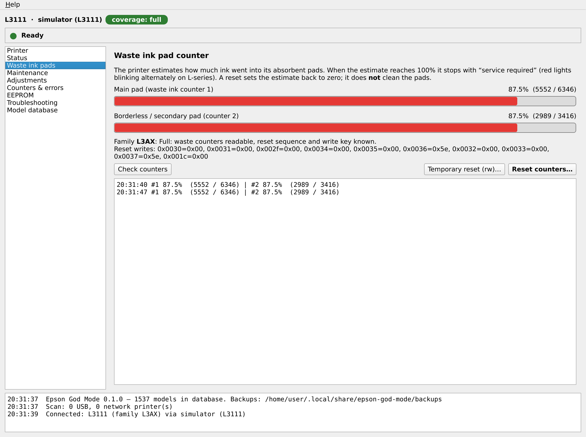
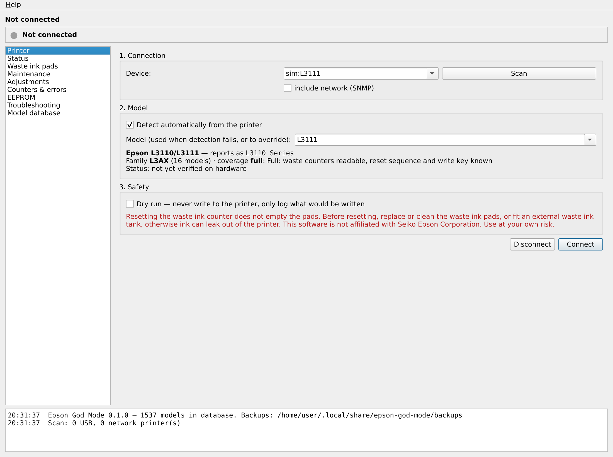
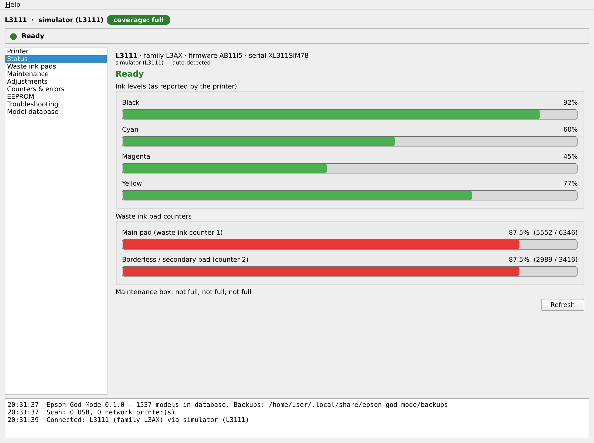
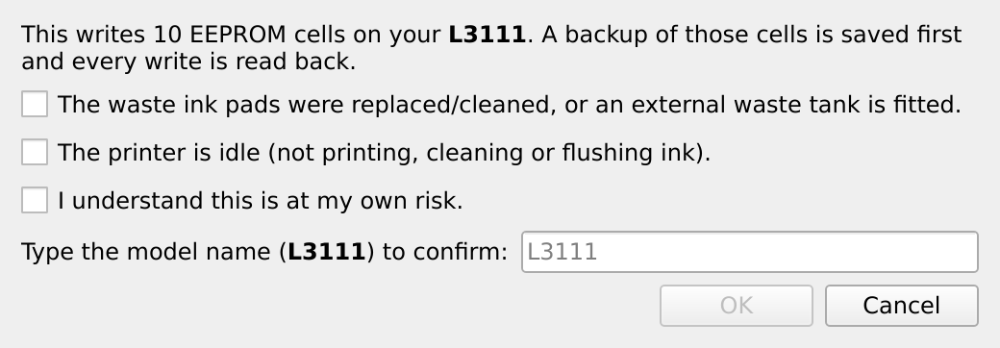
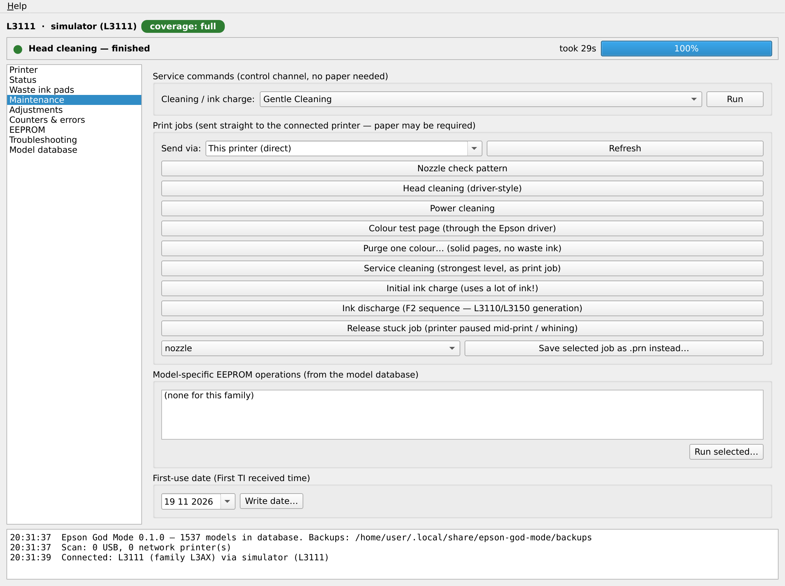
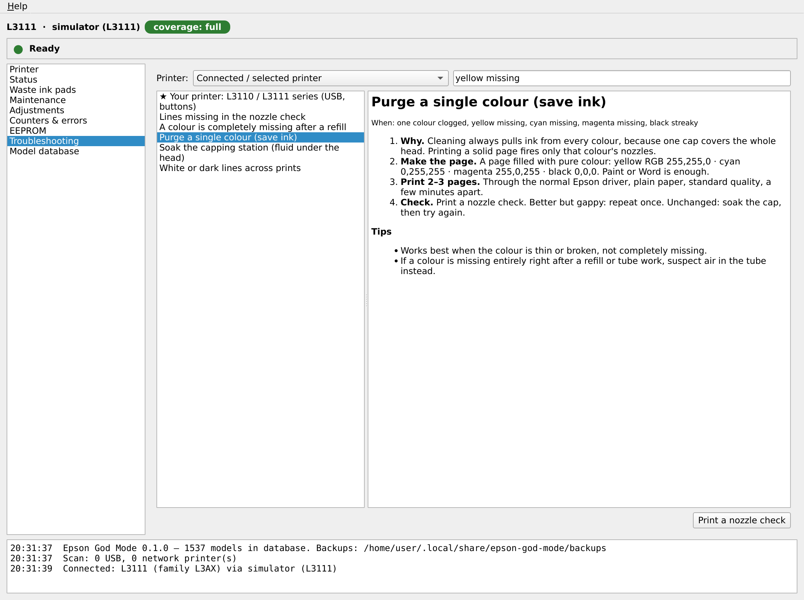
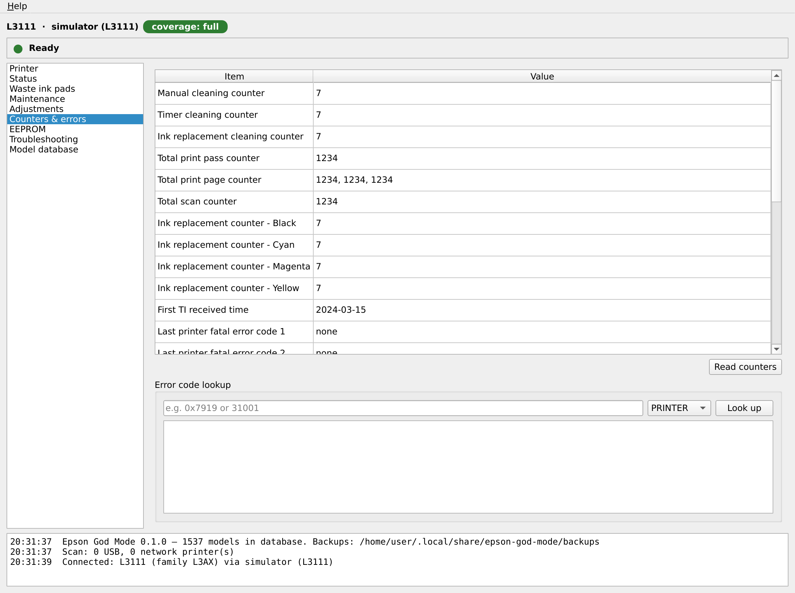
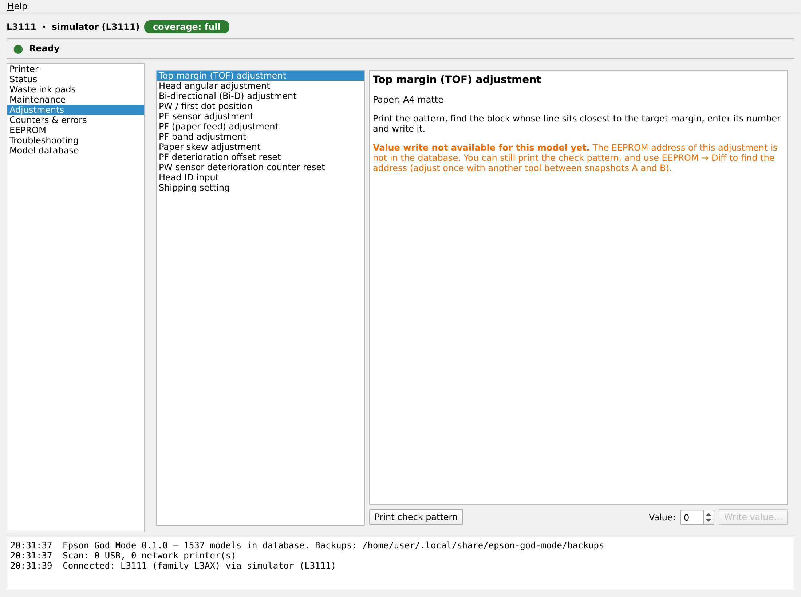
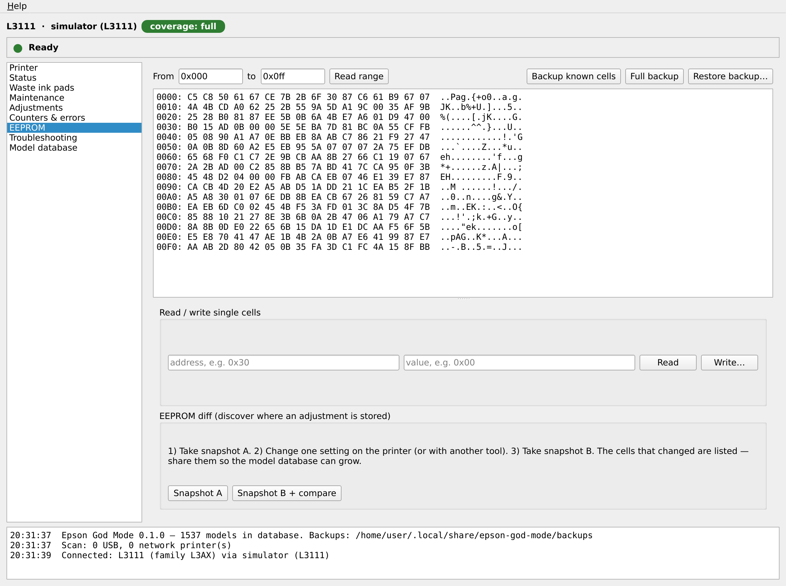
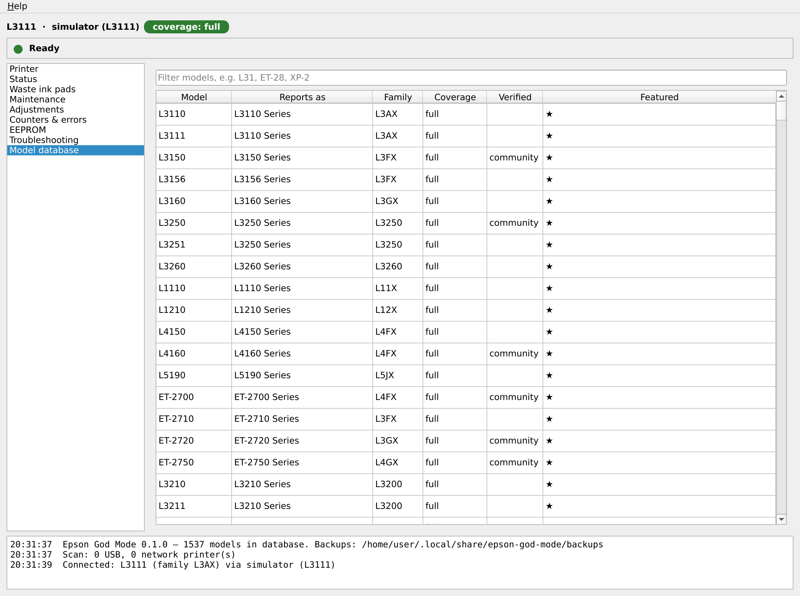

# Epson God Mode

Open-source **waste ink pad resetter, maintenance and adjustment tool** for Epson inkjet printers: EcoTank, L-series, ET-series, XP, WF and more. It runs on **Windows, macOS and Linux**, as a desktop app or from the command line.



> **Read this first.** Resetting the waste ink counter does **not** empty the pads. Replace or clean the waste ink pads, or fit an external waste ink tank, before resetting, or ink can leak out of the printer. This project is not affiliated with Seiko Epson Corporation. Use at your own risk.

**New here?** Read the illustrated **[step-by-step tutorial](docs/TUTORIAL.md)**. It needs no technical knowledge.

## Contents

* [What it does](#what-it-does)
* [Quick start](#quick-start)
* [A tour of the app](#a-tour-of-the-app)
* [Supported printers](#supported-printers)
* [Safety](#safety)
* [Command line](#command-line)
* [How it works](#how-it-works)
* [Project layout](#project-layout)
* [Development](#development)
* [Building standalone apps](#building-standalone-apps)
* [Adding or fixing a model](#adding-or-fixing-a-model)
* [Known limitations](#known-limitations)
* [Credits and license](#credits-and-license)

## What it does

| Area | Features |
|---|---|
| **Printer** | Auto-detection over USB (and SNMP on the network), manual model override, coverage and verification badges, a built-in simulator for any model |
| **Activity** | Live status strip on every page: what the printer is doing (ready, printing, cleaning, charging ink, busy, error), for how long, and an estimated progress bar for jobs started from the app. `egm watch` on the command line |
| **Status** | State and error, ink levels, warnings, maintenance box, serial number and firmware |
| **Waste ink pads** | Both counters as a percentage of the limit; reset with confirmation, automatic backup and read-back of every byte; completion-mask step for the L3250/L4260 generation; firmware `rw` temporary reset for locked firmwares |
| **Maintenance** | Gentle/normal/strong service cleaning and ink charge, with an automatic driver-style fallback and **confirmation** that the printer really did it; nozzle check, head and power cleaning, release a stuck job; **colour test page** and **purge one colour** printed through the installed Epson driver; factory service jobs; save any job as `.prn` |
| **Troubleshooting** | Offline help for 22 model series (155 models, from Epson's user guides): light patterns and screen codes, button combinations, plus 15 step-by-step guides (clogs, single-colour purge, cap soak, air in the tubes, waste pads, jams, app errors). Search by symptom |
| **Counters & errors** | Cleaning, page, pass and scan counters, ink replacement counters, first-use date, the last five fatal errors decoded, error code lookup across 26 Epson error tables |
| **Adjustments** | Catalogue of the service adjustments (TOF, head angle, Bi-D, PW/first dot, PE, PF, paper skew, deterioration resets, head ID, shipping setting) with guidance and check patterns. Value writes are enabled per model once the EEPROM address is verified |
| **EEPROM** | Range dump, known-cell or full backups, restore, single-cell read/write, and an **EEPROM diff** tool to find where a setting is stored |
| **Model database** | 1,537 model names in 395 families, each with a coverage level |

## Quick start

### Windows

* **Ready-made app (no Python):** download `EpsonGodMode.exe` from the build artifacts of the latest [Actions](https://github.com/iamandiradu/epson-god-mode/actions) run (or from Releases, once published) and double-click it. USB works through the normal Epson driver; no Zadig or WinUSB needed.
* **From source:** install Python 3.10+ from python.org, then double-click `run_windows.bat`. It creates a local environment and opens the app.

### macOS

* **Ready-made app:** open `EpsonGodMode-macos-<arch>.dmg` and drag **Epson God Mode** to Applications. If macOS says it cannot check the developer, right-click the app and choose **Open** (or see `docs/SIGNING.md` for signed builds).
* **From source:** double-click `run_macos.command`. libusb comes with `libusb-package`; if no printer is found, run `brew install libusb` and try again.

### Linux

```bash
pip install -e ".[patterns]"
egm gui
```

Raw USB access may need a udev rule or `sudo`.

### No printer at hand?

Type `sim:L3111` (or any model) as the device, or run `egm -d sim:L3111 info`. Everything works against the simulator, including resets and backups.

## A tour of the app

| | |
|---|---|
|  **Printer**: pick the USB or network printer, let the model be detected, optionally turn on *Dry run* |  **Status**: state, ink levels, waste counters and the always-visible activity strip |
|  **Waste ink pads**: counters as % of the limit, reset with backup and verification |  **Every write is confirmed**: a checklist plus typing the model name |
|  **Maintenance**: cleanings, nozzle check, colour test, single-colour purge, with a progress estimate |  **Troubleshooting**: search by symptom; per-model lights, button combos and guides |
|  **Counters & errors**: usage counters and the last fatal errors decoded |  **Adjustments**: the service adjustment catalogue with check patterns |
|  **EEPROM**: dump, backup, restore, single cells and the diff tool |  **Model database**: every model with its family and coverage |

The full walkthrough, with what every button does and recipes for common problems, is in **[docs/TUTORIAL.md](docs/TUTORIAL.md)**.

## Supported printers

All **455 EcoTank-style models** (L-series, ET-series, M-series) are featured in the model list, the most popular first: L3110, L3111, L3150, L3156, L3160, L3210–L3260, L1110, L1210, L1250, L4150, L4160, L4260, L5190, L5290, L6190, L805, L1800, L8050, L18050, L120, L121, L310, L380, L382, ET-2700, ET-2710, ET-2720, ET-2750, ET-2800, ET-2850, ET-4800, ET-4850 and their siblings. More than 1,000 other Epson models are in the database.

| Coverage | Meaning | Models |
|---|---|---|
| **full** | Waste counters, reset sequence and write key known | 991 |
| **partial** | Counters and reset known, write key missing: the printer will likely refuse writes | 84 |
| **readonly** | EEPROM readable, no reset data | 462 |

Models are also marked **verified (community)** when another open-source project confirmed them on hardware, and **verified (egm)** once confirmed by this project. Hardware test notes are in `docs/HARDWARE_TEST.md`.

## Safety

* Nothing is written to the printer without an explicit confirmation (and, for resets, typing the model name).
* Every write is preceded by an automatic **backup** and followed by a **read-back** check.
* **Dry run** (GUI checkbox or `--dry-run`) logs what would be written and writes nothing.
* Factory commands that the printer refuses are never retried blindly. The app reads the printer's status to explain why, and confirms maintenance by checking that the waste counter moved.
* Backups are stored in `%LOCALAPPDATA%\EpsonGodMode\backups` (Windows), `~/Library/Application Support/EpsonGodMode/backups` (macOS) or `~/.local/share/epson-god-mode/backups` (Linux). **Help → Open backup folder** opens it.

## Command line

```text
egm models [--all | --search L32]   # supported models
egm discover [--network]            # find printers
egm info                            # identify, ink levels, waste counters
egm status | egm waste | egm counters
egm reset-waste --i-replaced-the-pads [--dry-run]
egm temp-reset                      # firmware 'rw' temporary reset
egm clean [LEVEL] [--queue Q] [--no-fallback]   # list / run service cleaning or ink charge
egm print nozzle-check|release|head-clean|power-clean|color-test|service-clean|ink-charge|discharge
egm purge yellow --pages 3          # solid pages of one colour through the driver
egm troubleshoot "two lights flashing" [--first]
egm watch [--until-idle]            # live: Ready / Printing / Cleaning / Charging ink
egm dump --start 0 --end 0xff [--out FILE]
egm backup [--full] | egm restore FILE
egm read 0x30 0x31 | egm write 0x30=0 0x31=0
egm gui
```

Global options: `-d/--device` (`usb`, `usb:<path>`, `<ip>`, `sim:<MODEL>`), `-m/--model` to force a model, `--dry-run`, `-v`. Print jobs go straight to the connected printer; `--queue` sends them to a print queue name, `ip[:port]`, `/dev/usb/lpN` or `file:out.prn` instead. Driver-rendered pages (colour test, purge) accept `--queue pdf:preview.pdf`.

## How it works

```text
 GUI (PySide6)   CLI (argparse)
        \            /
     PrinterSession (operations.py)  ── backups, confirmations, activity tracking
        |            \
   EpsonCtrl          print jobs (printjobs.py, driverprint.py)
  (protocol.py)            |
        |                  |
  UsbLink / SnmpLink / SimLink (transport/)
        |
  EPSON-CTRL over IEEE 1284.4 (D4) on USB  ·  SNMP OID tunnel on the network
```

* **Control channel.** The app talks to the printer's **EPSON-CTRL** service. Over USB this goes through IEEE 1284.4 ("D4"), handled by the MIT-licensed [`epson-usb`](https://pypi.org/project/epson-usb/) package (Windows `USBPRINT`, libusb on macOS/Linux). Over the network the same frames are tunnelled through SNMP.
* **EEPROM.** Reads and writes use the `||` factory command with the model's read key and write key. The printer answers `@BDC PS … EE:AAAAVV;`, `:OK;` or `:NA;`.
* **Status.** `st` returns the `@BDC ST2` block (state, errors, ink, warnings), parsed into the status page and the activity strip.
* **Maintenance print jobs.** Nozzle check and head cleaning use Epson's remote-mode commands (`NC`, `CH`), framed exactly like gutenprint's `escputil`, and are written straight down the USB pipe. Factory service jobs use `ESC |` frames wrapped in the same service session as Epson's own recorded jobs.
* **Driver pages.** The colour test page and colour purge are drawn with Qt and printed through the installed Epson driver, which knows each model's head layout.
* **Model knowledge is data.** Keys, counters, reset sequences, cleaning codes, fatal error tables and troubleshooting are JSON files in `egm/data/`, generated from upstream sources by the scripts in `tools/`.

Many recent firmwares refuse EEPROM access over the network, and some refuse it entirely after a firmware update. Use USB, and if writes are refused (`:NA;`), try the temporary `rw` reset.

## Project layout

```text
egm/
  gui/            desktop app: app.py (pages, main window), widgets.py, workers.py
  transport/      usb.py (D4 + reconnect), snmp.py, sim.py (simulator), base.py
  data/           models.json, fatal_codes.json, troubleshooting.json, service_jobs.json, adjustments.json
  protocol.py     EPSON-CTRL frames, status parsing
  operations.py   PrinterSession: everything the GUI and CLI do
  printjobs.py    raw maintenance print jobs and delivery
  driverprint.py  colour test and purge pages through the printer driver
  activity.py     printer activity and progress estimates
  troubleshooting.py, modeldb.py, backup.py, cli.py
tools/            build_models.py, build_troubleshooting.py, screenshots.py, upstream/ (vendored data)
packaging/        PyInstaller spec, macOS and Windows build and signing scripts
docs/             TUTORIAL.md, HARDWARE_TEST.md, SIGNING.md, screenshots/
tests/            pytest suite (runs entirely against the simulator)
```

## Development

```bash
pip install -e ".[patterns,dev]"
pytest                                   # 46 tests, no printer needed
egm gui                                  # type sim:L310 as the device to use a simulated L310
QT_QPA_PLATFORM=offscreen python tools/screenshots.py   # regenerate docs/screenshots
```

Conventions:

* the GUI never talks to the printer on the UI thread; work goes through `gui/workers.Runner`;
* every printer write goes through `PrinterSession.write_cells` (backup, write, read-back);
* new model data goes into `tools/`, never by hand into `egm/data/`.

## Building standalone apps

* **Windows:** double-click `build_exe.bat`. You get `dist\EpsonGodMode.exe` (single file, runs without Python) and `dist\egm.exe` (command line). Building needs Python once; running the result does not.
* **macOS:** double-click `build_mac.command` on a Mac. You get `dist/Epson God Mode.app` and `dist/EpsonGodMode-macos-<arch>.dmg`.
* **CI:** `.github/workflows/build.yml` builds Windows, macOS arm64 and macOS Intel on every push to `main` and on `v*` tags.
* **Code signing** (Windows and macOS): see `docs/SIGNING.md`.

## Adding or fixing a model

All model knowledge is data. Edit the sources in `tools/upstream/` or the overrides in `tools/build_models.py`, run `python tools/build_models.py`, then `pytest`. Troubleshooting data lives in `tools/build_troubleshooting.py` (with links to Epson's guides); run it to regenerate `egm/data/troubleshooting.json`. To find the address of an adjustment, use **EEPROM → EEPROM diff**.

If you confirm a model on real hardware, please open an issue with the model, firmware, the log and what worked.

## Known limitations

* Some printers refuse the factory cleaning commands (`||:84:NA;`). The app then uses the driver-style cleaning and confirms it through the waste counter.
* The **initial ink charge** is not accepted by every model. On the L310 the printer refuses it both on the control channel and as a print job; use **Power cleaning** instead.
* The colour test page and colour purge need the Epson driver installed (they are printed through it).
* Adjustment value writes stay disabled until a model's EEPROM addresses are verified.
* Network access is read-only on most recent firmwares; use USB for resets.

## Credits and license

Built on the research of [epson_print_conf](https://github.com/Ircama/epson_print_conf), [reinkpy](https://codeberg.org/atufi/reinkpy), [ez-reset](https://github.com/CiRIP/ez-reset), [padzero](https://github.com/Damnitbran/padzero), [epson-usb](https://pypi.org/project/epson-usb/) and the original [ReInk](https://github.com/lion-simba/reink). Maintenance job framing follows gutenprint's `escputil`.

Because it includes AGPL-licensed model data, this project is licensed **AGPL-3.0-or-later** (see `LICENSE`). In short: you may use, change and share it freely; if you distribute it, or offer it as a service over a network, you must publish your source code under the same license.
