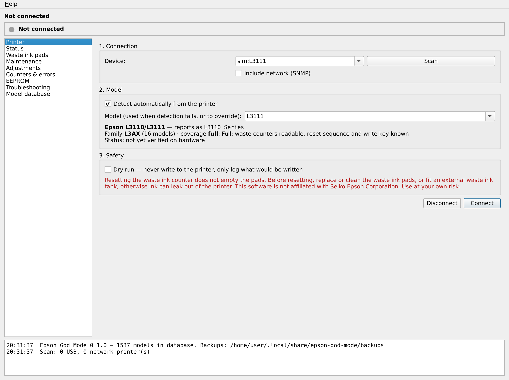
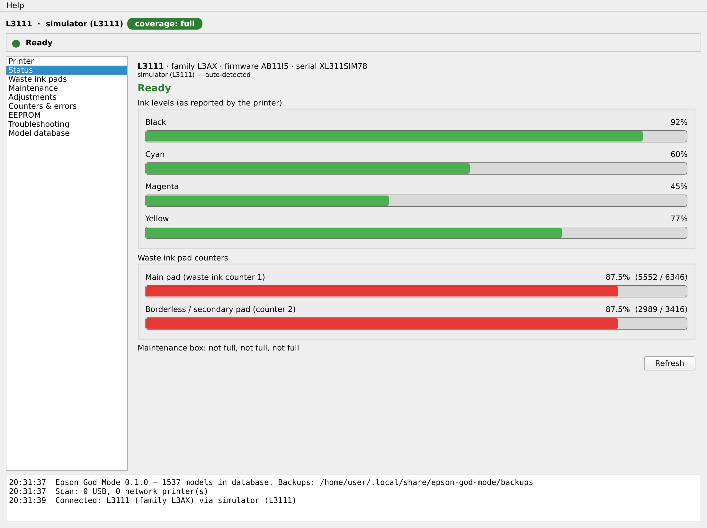
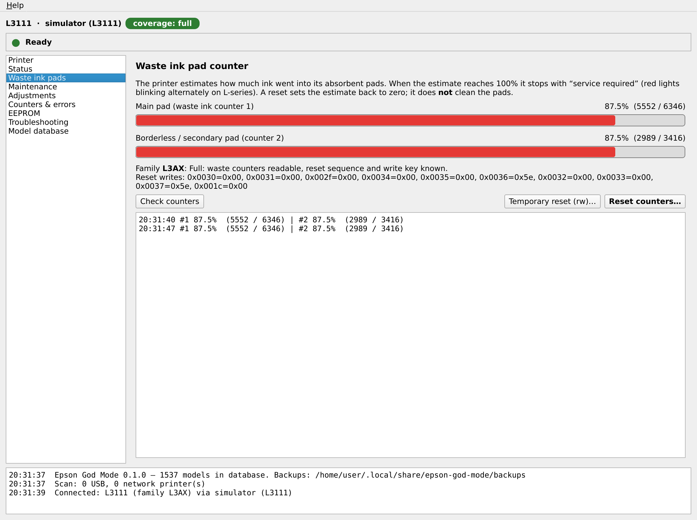
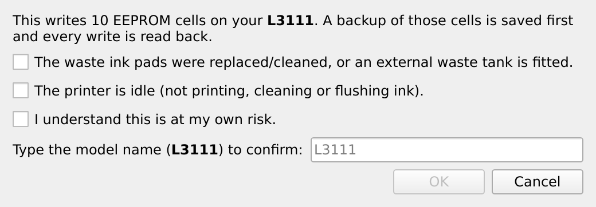
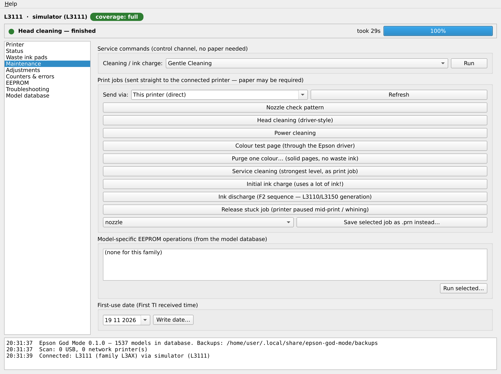
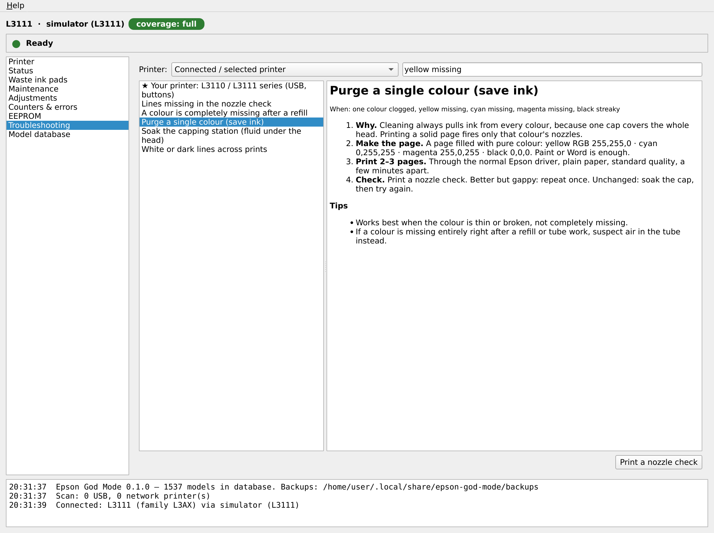
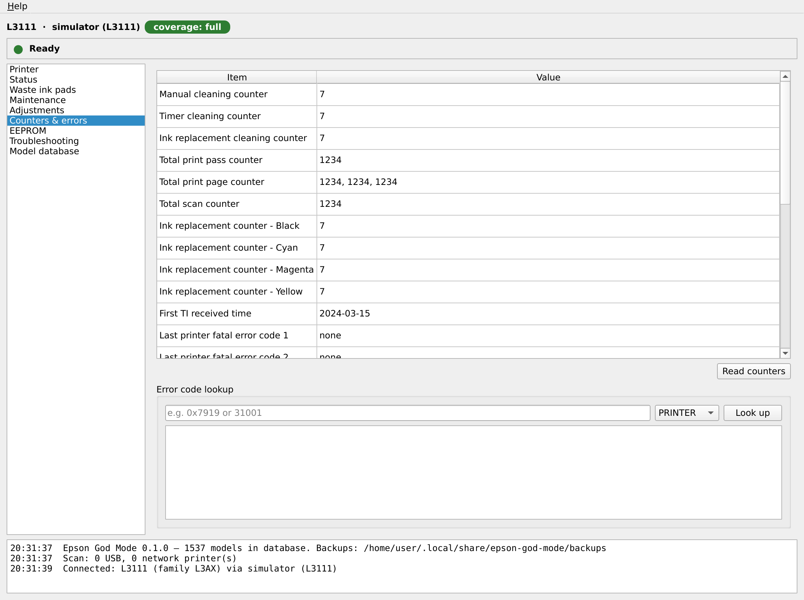
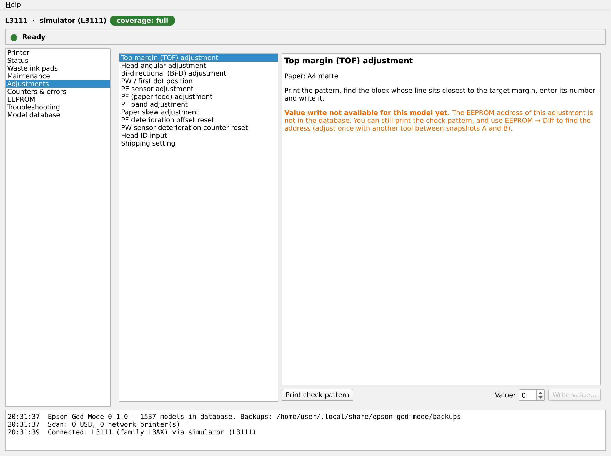
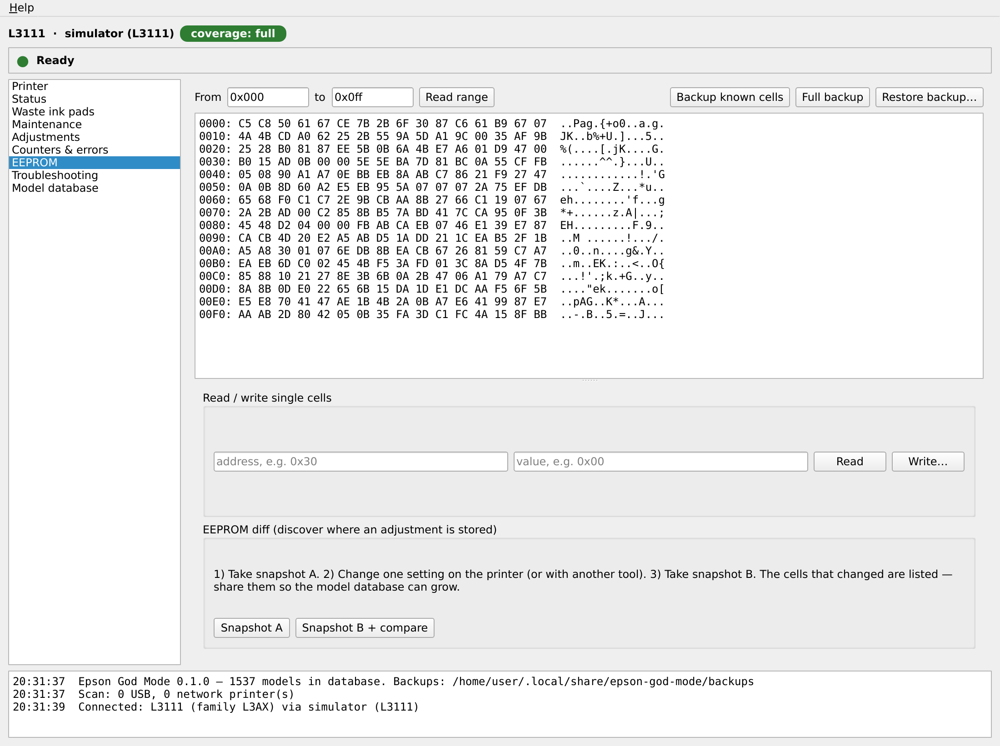
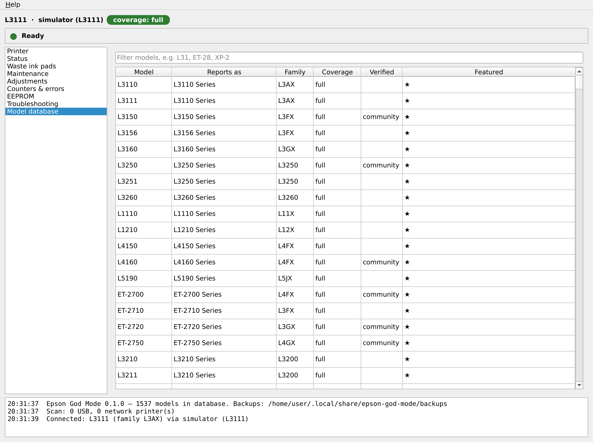

# Epson God Mode: step-by-step tutorial

This tutorial walks through the app screen by screen. You don't need to know anything about printers or programming to follow it. If you are technical, the [README](../README.md) has the command line, architecture and build details.

**Contents**

1. [What the app is for](#1-what-the-app-is-for)
2. [Before you start](#2-before-you-start)
3. [Install and open the app](#3-install-and-open-the-app)
4. [Connect to your printer](#4-connect-to-your-printer)
5. [Check the printer's status](#5-check-the-printers-status)
6. [Waste ink pads: check and reset](#6-waste-ink-pads-check-and-reset)
7. [Maintenance: nozzle check, cleaning, test pages](#7-maintenance-nozzle-check-cleaning-test-pages)
8. [Troubleshooting](#8-troubleshooting)
9. [Counters, errors and backups](#9-counters-errors-and-backups)
10. [Advanced: adjustments, EEPROM and the model database](#10-advanced-adjustments-eeprom-and-the-model-database)
11. [Common recipes](#11-common-recipes)
12. [When something goes wrong](#12-when-something-goes-wrong)
13. [Glossary](#13-glossary)

---

## 1. What the app is for

Epson ink tank printers (EcoTank, L-series, ET-series) keep track of how much ink they have flushed into small sponges inside the printer, called **waste ink pads**. When the printer thinks the pads are full, it stops working and asks for service, even if the rest of the printer is fine.

Epson God Mode lets you:

* **see** how full the waste ink pads are, and **reset** the counter after you have cleaned or replaced the pads;
* **look after the print head**: nozzle checks, cleanings, colour test pages, and purging a single colour without wasting ink;
* **see what the printer is doing**: ready, printing, cleaning, error, with a progress estimate;
* **fix common problems** with offline step-by-step guides for your model;
* **read** usage counters and the last errors the printer recorded;
* for advanced users: back up and edit the printer's internal memory (EEPROM).

It runs on **Windows, macOS and Linux** and works with **1,500+ Epson models**.

## 2. Before you start

> **Important.** Resetting the waste ink counter does **not** clean the pads. It only tells the printer they are empty. Before you reset, clean or replace the pads, or fit an external waste ink tank. Otherwise ink can leak out of the bottom of the printer.

You need:

* the printer connected to the computer **with a USB cable** (network works for status on some models, but most printers only accept resets over USB);
* the **Epson printer driver** installed (needed for the colour test page and colour purge);
* the printer **switched on and idle**: not printing, cleaning or charging ink.

The app never changes anything on the printer without asking you first, and it saves a backup before every write.

## 3. Install and open the app

**Windows (easiest):** download `EpsonGodMode.exe` and double-click it. No installation and no Python needed. If Windows SmartScreen warns about an unknown publisher, click **More info → Run anyway** (the app is open source; signed builds remove this warning).

**macOS:** open `EpsonGodMode-macos-<arch>.dmg` and drag **Epson God Mode** to Applications. The first time, right-click the app and choose **Open** if macOS says it cannot check the developer.

**From the source code** (any system, needs Python 3.10+): double-click `run_windows.bat` (Windows) or `run_macos.command` (macOS). The first start takes a minute while it installs what it needs.

Where to get the files: the build artifacts of the latest **Actions** run on the project's GitHub page (or the **Releases** section, once a release is published). You can also build them yourself, see [Building standalone apps](../README.md#building-standalone-apps).

## 4. Connect to your printer

The app opens on the **Printer** page.

1. **Device.** The app scans for printers by itself. Choose your printer from the list, or leave **usb (first Epson USB printer)**. Tick **include network (SNMP)** and press **Scan** to look for network printers too.
2. **Model.** Leave **Detect automatically from the printer** ticked. If detection fails, the model you pick in the list is used instead. The text below the list tells you how well your model is supported:
   * **full**: waste counters can be read and reset;
   * **partial**: counters can be read, but the printer will probably refuse a reset;
   * **readonly**: information only.
3. **Safety.** Tick **Dry run** if you want to try everything without changing the printer. The app then only writes in the log what it *would* do.
4. Press **Connect**.

When connected, the top bar shows the model, the connection and a coverage badge, and the app moves to the Status page.

> **Try it without a printer:** type `sim:L3111` (or any model, e.g. `sim:L310`) in the Device box and press Connect. That starts a built-in simulated printer. All the screenshots in this tutorial were made that way.

## 5. Check the printer's status

The **Status** page shows the model, firmware and serial number, the printer state (Ready, Printing, Error…), ink levels, the waste ink pad counters and the maintenance box. Press **Refresh** to read it again.

The **status strip** under the top bar is always visible, on every page. It shows what the printer is doing right now:

| Strip shows | Meaning |
|---|---|
| Ready | Idle, waiting for work |
| Printing / Cleaning / Charging ink | Busy. For jobs started from the app, a progress bar shows elapsed time and the usual duration |
| Working (port in use) | The printer's USB port is held by Windows or the Epson monitor, usually because it is printing |
| Error | Paper jam, cover open, ink low, service required… |

The printer never reports a percentage for cleanings, so the progress bar is an **estimate** based on how long that job usually takes. The real end comes from the printer reporting Ready again.

The log at the bottom records everything the app did. Copy it if you need to ask for help.

## 6. Waste ink pads: check and reset

The **Waste ink pads** page shows each counter as a percentage of its limit. At 100 % the printer stops with "service required" (on L-series, the two red lights blink alternately).

* **Check counters** reads them again.
* **Reset counters…** sets them back to zero. The app asks you to confirm three things and type the model name:

What happens when you confirm:

1. the current values are **backed up** to a file;
2. the new values are written;
3. every value is **read back** to make sure it was stored;
4. the result is shown (`RESULT: OK` or `FAILED`).

Then **turn the printer off and on again**.

**Temporary reset (rw)…** is for printers with newer firmware that refuse a normal reset. It asks the printer itself for a temporary reset. It is not available on all models.

If a reset ever goes wrong, restore the backup from the **EEPROM** page (**Restore backup…**). **Help → Open backup folder** shows where backups are stored.

## 7. Maintenance: nozzle check, cleaning, test pages

The **Maintenance** page has three parts.

### Service commands (top)

Pick a cleaning level and press **Run**: Gentle, Normal or Strong cleaning, or an ink charge, depending on what your model supports. These are sent straight to the printer, no paper needed.

Some printers refuse these commands. The app then automatically sends the same kind of cleaning the Epson driver uses, and **confirms that it really happened** by checking that the waste ink counter went up. The log tells you which way was used and whether it worked.

### Print jobs (middle)

**Send via** is normally **This printer (direct)**: the job goes straight to the connected printer. Choose an installed print queue only if you want to go through the normal Windows/macOS printing system.

| Button | What it does | Paper? | Uses ink? |
|---|---|---|---|
| **Nozzle check pattern** | Prints the test grid. Every line should be complete; gaps mean blocked nozzles | yes | a little |
| **Head cleaning (driver-style)** | The same cleaning as the Epson driver's "Head Cleaning" | no | some, goes to the pads |
| **Power cleaning** | Stronger cleaning, for stubborn clogs or air in the tubes | no | a lot |
| **Colour test page (through the Epson driver)** | One page with colour blocks, gradients and fine lines, printed by your installed driver | yes | some |
| **Purge one colour…** | 1–5 solid pages of **one** ink (yellow, cyan, magenta or black). Flushes a weak colour **without** filling the waste pads | yes | that colour only |
| **Service cleaning (strongest level, as print job)** | The factory strong cleaning | no | a lot |
| **Initial ink charge** | Refills empty tubes and head (used after a head swap or when tubes are full of air). Not every model accepts it, see [section 12](#12-when-something-goes-wrong) | no | **a lot** |
| **Ink discharge (F2 sequence)** | Experimental, L3110/L3150 generation only | no | yes |
| **Release stuck job** | Ends a page the printer is stuck on (paused mid-print, high-pitched whine) | no | no |

**Save selected job as .prn instead…** saves a job to a file instead of sending it, for example to send it later with another tool.

*The colour test page. Blocks should be solid, gradients smooth, lines straight and continuous.*

### Model-specific operations and first-use date (bottom)

Some models have extra memory operations listed in the database. **Write date…** sets the printer's "first use" date.

> **Saving ink:** run a nozzle check first. If only one colour is weak, use **Purge one colour** before any cleaning. Run cleanings one at a time and wait for the strip to show **Ready** before starting the next. Back-to-back cleanings mostly fill the waste pads.

## 8. Troubleshooting

The **Troubleshooting** page works offline. Type the problem in your own words in the search box, for example *yellow missing*, *two lights flashing*, *E-11* or *paper jam*.

* **★ Your printer** shows your model's light patterns and screen codes, the button combinations for nozzle check and cleaning, and model-specific tips.
* Below it are step-by-step **guides** for 15 common problems: clogged nozzles, purging a single colour, soaking the capping station, air in the tubes, full waste pads, paper jams, app errors and more.
* Buttons under a guide run the matching action, for example **Print a nozzle check** or **Open Waste ink pads**.

Use **Printer:** to look at another model's help. 155 models in 22 series have their own data; every other model gets generic help.

From the command line: `egm troubleshoot "yellow missing"`.

## 9. Counters, errors and backups

**Counters & errors** shows how much the printer has been used: cleanings, printed pages and passes, scans, ink refills, the first-use date, and the **last five fatal errors** with their meaning. Press **Read counters** to load them.

**Error code lookup** explains an error code you have seen on the printer or in another tool (for example `0x7919` or `31001`).

## 10. Advanced: adjustments, EEPROM and the model database

These pages are for experienced users. You do not need them for resets or cleaning.

### Adjustments

The list of adjustments from Epson's service tool: top margin, head angle, bi-directional alignment, paper feed, head ID and more. Each item explains what it does and can print its check pattern. Writing a value is only enabled once the memory address for that model is verified; until then the page tells you so.

### EEPROM

The printer's settings memory:

* **Read range** shows a hex dump;
* **Backup known cells** / **Full backup** / **Restore backup…** save and restore it;
* **Read** / **Write…** work on single cells;
* **EEPROM diff**: take Snapshot A, change one setting on the printer, take Snapshot B. The cells that changed are listed. This is how new adjustments get added to the database.

### Model database

Every supported model with its family, how it reports itself, coverage level and verification status. Type in the filter box to search, for example `L31` or `ET-28`.

## 11. Common recipes

**The printer says "service required" / red lights blink alternately**

1. Clean or replace the waste ink pads, or fit an external waste tank.
2. Connect, then open **Waste ink pads** and check the counters.
3. **Reset counters…**, confirm, then turn the printer off and on.

**Lines are missing in the nozzle check**

1. **Nozzle check pattern**.
2. If only one colour is affected: **Purge one colour…**, 2–3 pages, then another nozzle check.
3. Otherwise run **one** Normal cleaning, wait for Ready, then another nozzle check.
4. Still bad after two or three cleanings: follow **Troubleshooting → Lines missing in the nozzle check** (cap soak, rest overnight).

**A colour is completely missing after refilling**

Check the tank level and look for air gaps in that colour's tube. Air needs one **Power cleaning** (or an ink charge where supported), not repeated normal cleanings. See **Troubleshooting → A colour is completely missing after a refill**.

**The printer stopped mid-page and whines**

Press **Release stuck job** on the Maintenance page.

## 12. When something goes wrong

| What you see | What to do |
|---|---|
| No printer found | Check the USB cable and that the printer is on. On macOS, install libusb (`brew install libusb`). Try the model list with detection turned off |
| `WinErr 5 (ACCESS_DENIED)` in the log | Windows was briefly using the port. The app reconnects by itself; the log says when the link is back |
| `refused … (||:84:NA;)` | The printer refused a factory command. For cleanings the app falls back to the driver-style cleaning automatically |
| "not confirmed — waste ink counter did not change" | The printer ignored the command. Some models (for example the L310) do not accept the factory ink charge; use **Power cleaning** instead |
| Reset `FAILED` | The printer refused the write (newer firmware). Try **Temporary reset (rw)…**. Restore the backup from the EEPROM page if needed |
| "No printer driver" when printing the colour test or purge | Install the Epson driver for your printer; these pages are printed through it |
| Strip stays on "Working (port in use)" | A print job is running or stuck. Check the Windows print queue and cancel old jobs |

If you report a problem, include the model, your operating system and the log lines from the bottom of the window.

## 13. Glossary

| Term | Meaning |
|---|---|
| **Waste ink pads** | Sponges inside the printer that soak up ink flushed during cleanings |
| **Waste ink counter** | The printer's estimate of how full the pads are |
| **Nozzle check** | A test print that shows whether every nozzle of the print head fires |
| **Head cleaning / power cleaning** | The printer sucks ink through the head to clear blocked nozzles. Power cleaning is stronger and uses more ink |
| **Ink charge** | Fills empty ink tubes and the print head. Uses a lot of ink |
| **Purge** | Printing solid pages of one colour to pull fresh ink through without a cleaning |
| **Capping station** | The rubber cap the print head rests on when parked |
| **Damper** | Small ink chamber on top of the print head where each tube connects |
| **EEPROM** | The printer's small settings memory, where counters and adjustments are stored |
| **Dry run** | Test mode: nothing is written to the printer |
| **Coverage** | How much the app knows about a model: full, partial or readonly |
